# [📈 Live Status](https://Acid3croco.github.io/upptime): <!--live status--> **🟩 All systems operational**

This repository contains the open-source uptime monitor and status page for [Acid3croco](yoannditte.com), powered by [Upptime](https://github.com/upptime/upptime).

With [Upptime](https://upptime.js.org), you can get your own unlimited and free uptime monitor and status page, powered entirely by a GitHub repository. We use [Issues](https://github.com/Acid3croco/upptime/issues) as incident reports, [Actions](https://github.com/Acid3croco/upptime/actions) as uptime monitors, and [Pages](https://Acid3croco.github.io/upptime) for the status page.

<!--start: status pages-->
<!-- This summary is generated by Upptime (https://github.com/upptime/upptime) -->
<!-- Do not edit this manually, your changes will be overwritten -->
<!-- prettier-ignore -->
| URL | Status | History | Response Time | Uptime |
| --- | ------ | ------- | ------------- | ------ |
|  [depannemoi](https://depanne.veyxzer.com/login) | 🟩 Up | [depannemoi.yml](https://github.com/Acid3croco/upptime/commits/HEAD/history/depannemoi.yml) | 

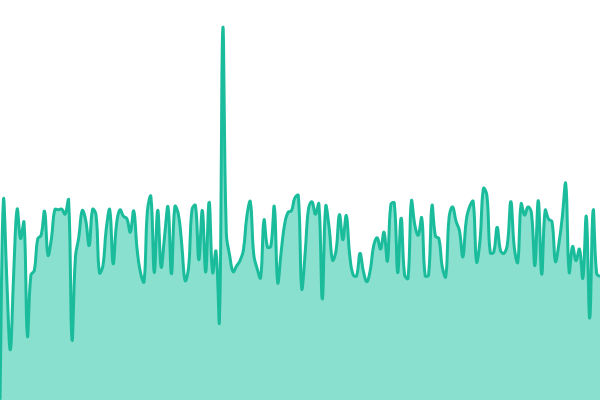 733ms
     
 | 

<a href="https://Acid3croco.github.io/upptime/history/depannemoi">100.00%</a>
    

|  [mail](https://mail.veyxzer.com/) | 🟩 Up | [mail.yml](https://github.com/Acid3croco/upptime/commits/HEAD/history/mail.yml) | 

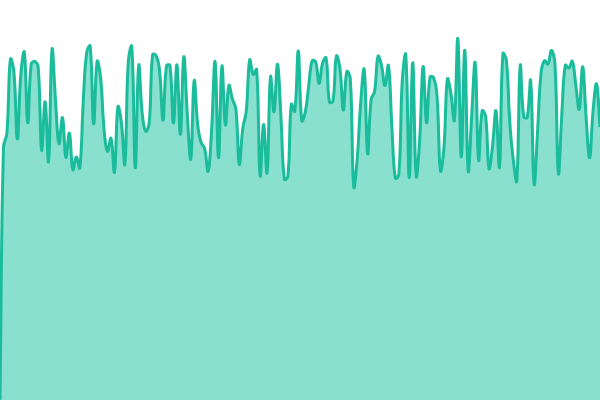 1456ms
     
 | 

<a href="https://Acid3croco.github.io/upptime/history/mail">100.00%</a>
    

|  [massif-studio](https://massif-studio.com/) | 🟩 Up | [massif-studio.yml](https://github.com/Acid3croco/upptime/commits/HEAD/history/massif-studio.yml) | 

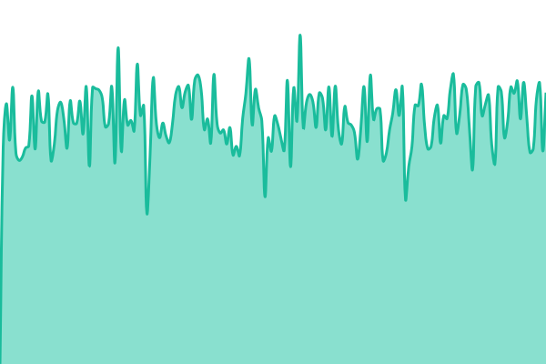 3035ms
     
 | 

<a href="https://Acid3croco.github.io/upptime/history/massif-studio">100.00%</a>
    

|  [x-med](https://x-med.ia-do-it.com/) | 🟩 Up | [x-med.yml](https://github.com/Acid3croco/upptime/commits/HEAD/history/x-med.yml) | 

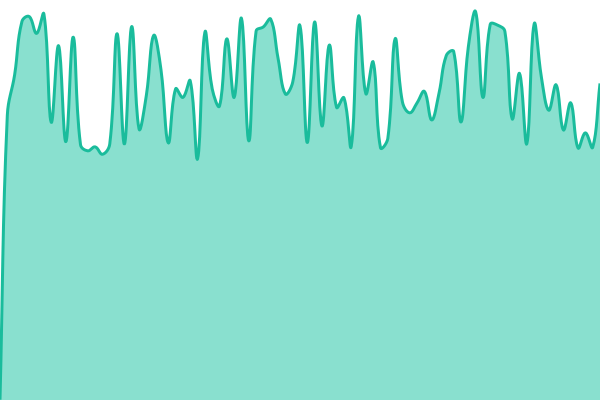 1129ms
     
 | 

<a href="https://Acid3croco.github.io/upptime/history/x-med">100.00%</a>
    

|  [devboost](https://devboost.veyxzer.com/) | 🟩 Up | [devboost.yml](https://github.com/Acid3croco/upptime/commits/HEAD/history/devboost.yml) | 

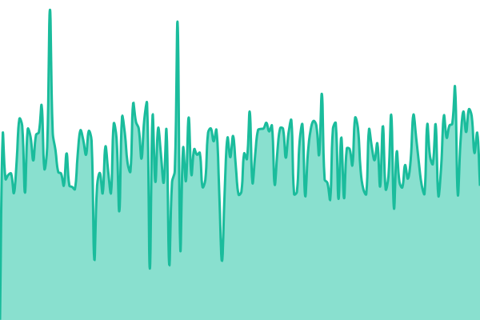 726ms
     
 | 

<a href="https://Acid3croco.github.io/upptime/history/devboost">100.00%</a>
    

|  [devboost-evadoit](https://devboost.evadoit.com/) | 🟩 Up | [devboost-evadoit.yml](https://github.com/Acid3croco/upptime/commits/HEAD/history/devboost-evadoit.yml) | 

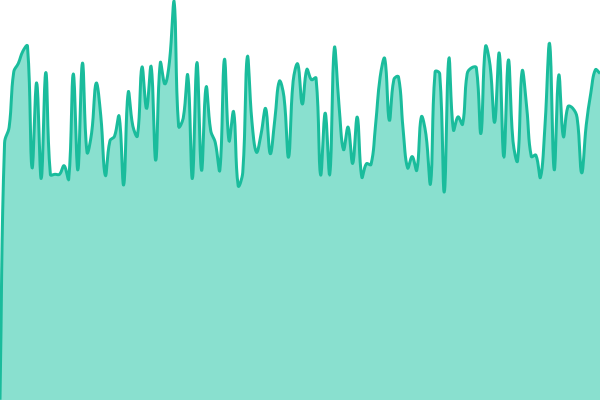 1013ms
     
 | 

<a href="https://Acid3croco.github.io/upptime/history/devboost-evadoit">100.00%</a>
    

|  [massifier](https://massifier.veyxzer.com/) | 🟩 Up | [massifier.yml](https://github.com/Acid3croco/upptime/commits/HEAD/history/massifier.yml) | 

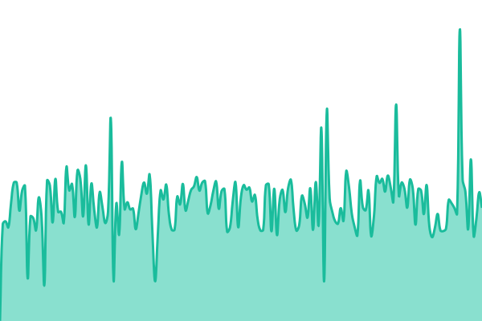 742ms
     
 | 

<a href="https://Acid3croco.github.io/upptime/history/massifier">100.00%</a>
    

|  [massifier-3](https://massifier-3.veyxzer.com/) | 🟩 Up | [massifier-3.yml](https://github.com/Acid3croco/upptime/commits/HEAD/history/massifier-3.yml) | 

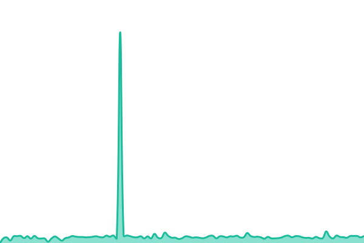 732ms
     
 | 

<a href="https://Acid3croco.github.io/upptime/history/massifier-3">100.00%</a>
    

|  [pure-vibe-society](https://pure-vibe-society.club/) | 🟩 Up | [pure-vibe-society.yml](https://github.com/Acid3croco/upptime/commits/HEAD/history/pure-vibe-society.yml) | 

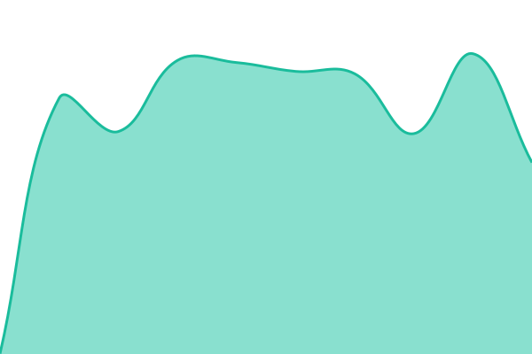 906ms
     
 | 

<a href="https://Acid3croco.github.io/upptime/history/pure-vibe-society">100.00%</a>
    

|  [packgame](https://packgame.veyxzer.com/) | 🟩 Up | [packgame.yml](https://github.com/Acid3croco/upptime/commits/HEAD/history/packgame.yml) | 

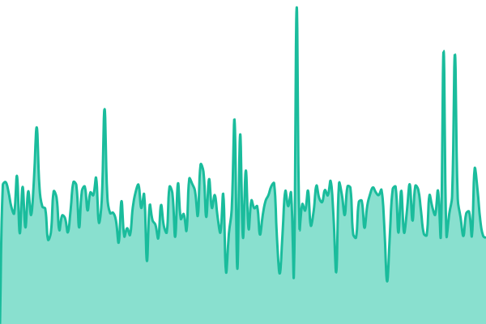 915ms
     
 | 

<a href="https://Acid3croco.github.io/upptime/history/packgame">100.00%</a>
    

|  [bingo](https://bingo.veyxzer.com/) | 🟩 Up | [bingo.yml](https://github.com/Acid3croco/upptime/commits/HEAD/history/bingo.yml) | 

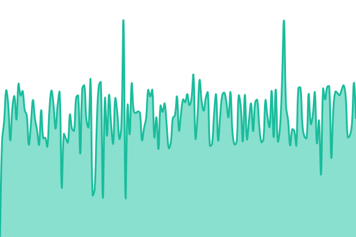 714ms
     
 | 

<a href="https://Acid3croco.github.io/upptime/history/bingo">100.00%</a>
    

|  [viz](https://viz.veyxzer.com/) | 🟩 Up | [viz.yml](https://github.com/Acid3croco/upptime/commits/HEAD/history/viz.yml) | 

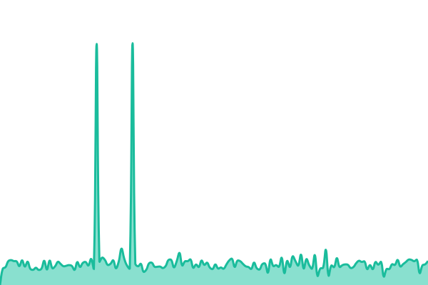 872ms
     
 | 

<a href="https://Acid3croco.github.io/upptime/history/viz">100.00%</a>
    

|  [viz-asso6](https://viz.asso6.com/) | 🟩 Up | [viz-asso6.yml](https://github.com/Acid3croco/upptime/commits/HEAD/history/viz-asso6.yml) | 

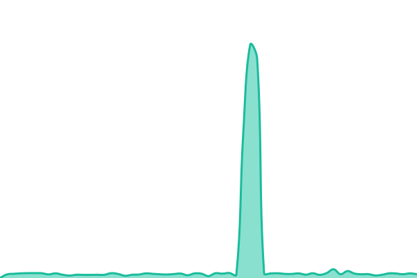 883ms
     
 | 

<a href="https://Acid3croco.github.io/upptime/history/viz-asso6">100.00%</a>
    

<!--end: status pages-->

[**Visit our status website →**](https://Acid3croco.github.io/upptime)

## 📄 License

- Powered by: [Upptime](https://github.com/upptime/upptime)
- Code: [MIT](./LICENSE) © [Anand Chowdhary](https://anandchowdhary.com)
- Data in the `./history` directory: [Open Database License](https://opendatacommons.org/licenses/odbl/1-0/)
